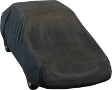
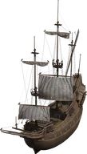
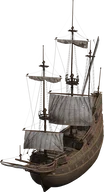
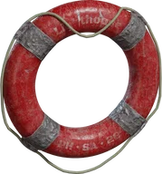
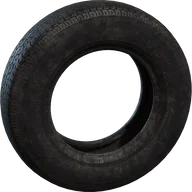
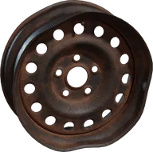
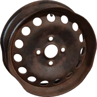
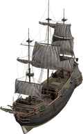

# Poly Haven: Vehicles & Transport models

**11 assets from [Poly Haven](https://polyhaven.com), dedicated to the public domain under [CC0](https://polyhaven.com/license).** Use them in any game, free or paid, and change them however you like; no credit is needed.

3D models as glTF at 1K and 2K texture resolution, each folder self-contained (`.gltf`, `.bin`, `textures/`). 275.2 MB in all.

This is a copy kept by [zuujis-cc0](https://github.com/zuujis-cc0) so game makers can take single files from GitHub. It is not made by or affiliated with Poly Haven: the originals, often in more formats and higher resolutions, are on [polyhaven.com](https://polyhaven.com). If they help you, consider [supporting Poly Haven](https://www.patreon.com/polyhaven/overview).

Every file is listed in [MANIFEST.tsv](MANIFEST.tsv) with its size and SHA-256. More free assets: [the Zuujis collection](https://github.com/zuujis-cc0/free-game-assets#readme).

| | | | |
| :-: | :-: | :-: | :-: |
|  <b><a href="covered_car">Covered Car</a></b> by MP · <a href="https://polyhaven.com/a/covered_car">source</a> |  <b><a href="dutch_ship_large_01">Dutch Ship Large 01</a></b> by James Ray Cock, Nicolò Zubbini, Rico Cilliers · <a href="https://polyhaven.com/a/dutch_ship_large_01">source</a> |  <b><a href="dutch_ship_large_02">Dutch Ship Large 02</a></b> by James Ray Cock, Nicolò Zubbini, Rico Cilliers · <a href="https://polyhaven.com/a/dutch_ship_large_02">source</a> |  <b><a href="dutch_ship_medium">Dutch Ship Medium</a></b> by James Ray Cock, Nicolò Zubbini, Rico Cilliers · <a href="https://polyhaven.com/a/dutch_ship_medium">source</a> |
|  <b><a href="lateral_sea_marker">Lateral Sea Marker</a></b> by James Ray Cock, Kuutti Siitonen · <a href="https://polyhaven.com/a/lateral_sea_marker">source</a> |  <b><a href="lifebuoy">Lifebuoy</a></b> by Hank Kaamura · <a href="https://polyhaven.com/a/lifebuoy">source</a> |  <b><a href="ocean_buoy">Ocean Buoy</a></b> by Mateusz Sadek · <a href="https://polyhaven.com/a/ocean_buoy">source</a> |  <b><a href="old_tyre">Old Tyre</a></b> by MP · <a href="https://polyhaven.com/a/old_tyre">source</a> |
|  <b><a href="rusted_wheel_rim_01">Rusted Wheel Rim 01</a></b> by John Hutcheson · <a href="https://polyhaven.com/a/rusted_wheel_rim_01">source</a> |  <b><a href="rusted_wheel_rim_02">Rusted Wheel Rim 02</a></b> by John Hutcheson · <a href="https://polyhaven.com/a/rusted_wheel_rim_02">source</a> |  <b><a href="ship_pinnace">Ship Pinnace</a></b> by James Ray Cock, Nicolò Zubbini, Rico Cilliers, Yann Kervran · <a href="https://polyhaven.com/a/ship_pinnace">source</a> |  |

---

Kept up to date by this repository's own [update workflow](.github/workflows/update.yml), with code and plan from [cc0-mirror](https://github.com/zuujis-cc0/cc0-mirror). Something wrong? [Open an issue there](https://github.com/zuujis-cc0/cc0-mirror/issues/new) or use the [private report form](https://games.zuujis.com/report).
